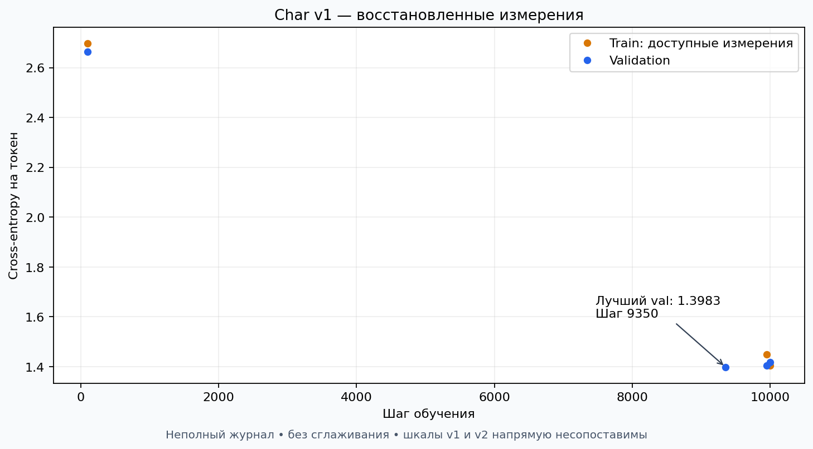
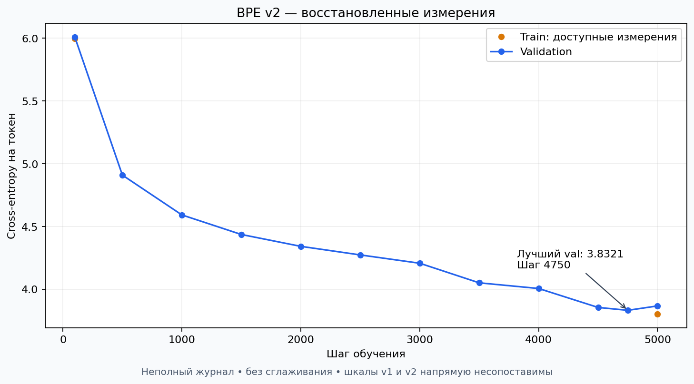

# LLM Training Lab

[Русский](README.md) · **English**

A PyTorch learning project on language model pretraining from scratch. It implements a decoder-only Transformer and trains two small versions to continue Russian text. **Char v1** predicts characters and **BPE v2** predicts byte-level BPE tokens. The repository covers pretraining. SFT and RL were outside the project.

## Architecture

`src/model.py` implements learned token and position embeddings, causal multi-head self-attention, and feed-forward blocks with pre-layer normalization and residual connections. The feed-forward layer expands to four times the embedding size and uses ReLU. The triangular mask prevents attention to future positions. Head outputs are concatenated. The model omits a separate attention output projection, final LayerNorm, and dropout. The output layer produces vocabulary logits. The training target is offset by one token, with cross-entropy and AdamW.

| Setting | Char v1 | BPE v2 |
|---|---|---|
| Tokenization | Characters | Byte-level BPE |
| Vocabulary | 86 | 2,048 |
| Context | 128 characters | 256 BPE tokens |
| Embedding width | 128 | 128 |
| Layers / heads | 6 / 4 | 6 / 4 |
| Parameters | 1,126,742 | 1,647,360 |
| Training steps | 10,000 | 5,000 |
| Best validation loss | 1.3983 at step 9,350 | 3.8321 at step 4,750 |
| Final train / validation loss | 1.4039 / 1.4185 | 3.8036 / 3.8669 |

Both runs use batch size 4, learning rate 0.001, and evaluation on 20 sampled batches every 50 steps. The best losses were checked against the local checkpoints. Loss is measured per token. Different tokenizations, contexts, and splits make the losses unsuitable for a direct cross-version ranking.

## Training curves





The plots use the available records. Char has a few recovered observations, and BPE training loss was available at steps 100 and 5,000. Intermediate BPE validation points came from a saved chart. The full historical log was unavailable. [Metric sources and missing values](reports/README.md)

## Generated text

Actual outputs are kept in Russian. The prompt was `Однажды мальчик`.

**Char v1** used temperature 0.7, top-k 20, and 200 new characters.

```text
Однажды мальчик и появилось заявильный автомобиль, который ластатель был отличной. Её собака проснулись своему счастлив. Коллад лет подарить в времённой картину.Накончина оставилась со своим проездким посоверном. Он
```

**BPE v2** used temperature 0.65, top-k 40, and 100 new tokens.

```text
Однажды мальчик в свой дом. Он сказал, что не хватало. В следующий день он вернулся домой.

Мальчик был самый месяц. Он сказал мне, что он не может уходить. Он солёт вниз ине смог найти. Он был в восторге от дома.

Олли устала, чтобы она не знала. Она выставала, что хочет. Когда она была в восторге от этого ей конфеты. Она нервничала, что не была в
```

The models generate recognizable Russian words and some sentence patterns, but agreement, names, and story continuity often fail. The seeds for these generated samples were not retained.

## Run on Windows

Verified with Python 3.10 and PyTorch 2.11.0+cu126. The scripts use CUDA when available and fall back to CPU. [PyTorch installation guide](https://pytorch.org/get-started/locally/)

```powershell
git clone https://github.com/Awuiga/llm-training-lab.git
cd llm-training-lab
py -3.10 -m venv .venv
.\.venv\Scripts\Activate.ps1
python -m pip install -r requirements.txt
python -c "import torch; print(torch.__version__); print('CUDA:', torch.cuda.is_available())"
python src/smoke_check.py
```

### Prepare data

The project uses Ilya Koziev's `ru_stories` dataset under CC BY-NC 4.0. [Dataset](https://huggingface.co/datasets/inkoziev/ru_stories) · [Data and tokenizer terms](DATA_LICENSE.md)

```powershell
python src/prepare_data.py
python src/prepare_v2_data.py
python src/encode_v2_data.py
```

`prepare_data.py` makes `data/stories.txt` from the five sentences in each story. For BPE, the stories are shuffled and split 90/10 with seed 42. There were 49,288 train and 5,477 validation stories, yielding 4,294,381 and 477,488 BPE tokens. Encoding uses the included tokenizer. `python src/train_tokenizer.py` trains another tokenizer and overwrites that JSON. Keep the matching tokenizer when using an existing checkpoint.

### Train and generate

Run the pair for the version you want. The seed is optional for a new run.

```powershell
$env:LLM_SEED = '42'

# Char v1
python src/data.py
python src/generate.py

# BPE v2
python src/train_v2.py
python src/generate_v2.py
```

Checkpoints are stored in `experiments/char_v1/` and `experiments/bpe_v2/`. An existing `last_checkpoint.pt` resumes the run to the configured total step count. Use a fresh copy for an independent run. Generation uses `best_checkpoint.pt` after training, or set `$env:LLM_CHECKPOINT` to a trusted compatible local file.

Rebuild the plots from the included CSVs.

```powershell
python src/plot_losses.py
```

## Reproducibility and limitations

- Char v1 splits a continuous character stream, so a story may straddle the split. Its vocabulary uses the full text. BPE splits whole stories and learns merges on train alone. Cross-split duplicate stories were not checked.
- Validation uses uneven samples of random batches, and the original test split was not evaluated. A small gap between the last and best loss can arise from sampling.
- The historical training seeds and dataset revision were not saved. Resume restores weights and AdamW, but not RNG state. Fingerprints are available to compare regenerated files. [Fingerprints](reports/data_fingerprints.json)
- The small model has limited context and coherence. It was trained to continue text and received no instruction tuning.
- The release includes the original architecture, an optional seed, CPU fallback, separate checkpoint locations, and a pinned dataset revision. Corpus text and weights are generated locally. [Verification](reports/verification.md)
