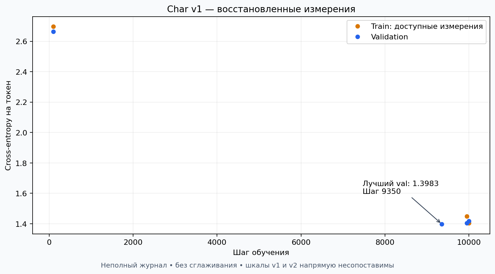
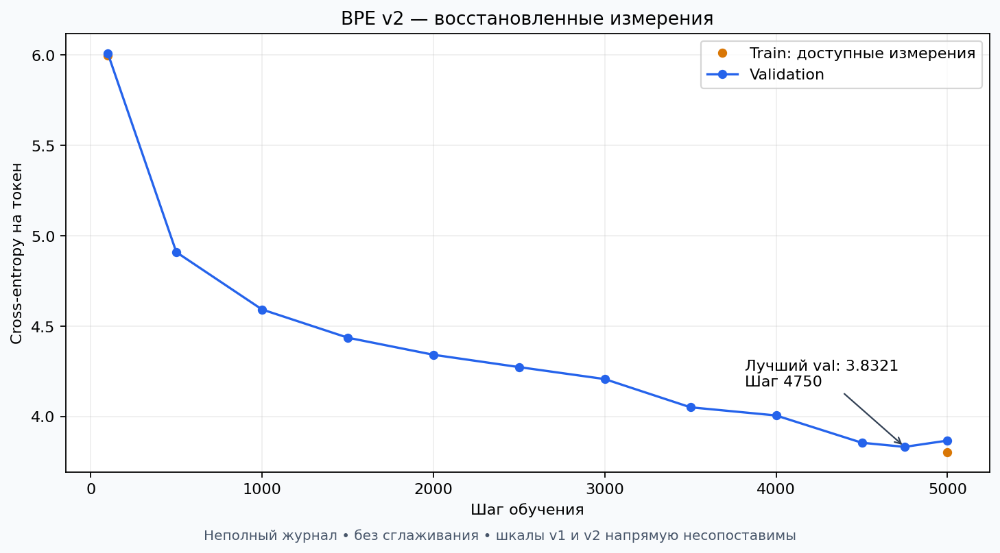

# LLM Training Lab

Учебный проект по обучению языковой модели с нуля на PyTorch. Здесь я разбирался, как из токенов, attention и обычного цикла обучения получается модель, которая продолжает русский текст.

В репозитории два эксперимента: символьная модель **char v1** и модель с **BPE v2**. Обе обучены предсказывать следующий токен на коротких историях. Они уже воспроизводят слова и некоторые конструкции предложений, но пока плохо удерживают смысл и сюжет. Это завершённый учебный этап pretraining; SFT и RL в этом проекте не выполнялись.

## Что внутри

Decoder-only Transformer реализован в `src/model.py`: эмбеддинги токенов и обучаемые позиции, затем блоки с causal multi-head self-attention и feed-forward, в конце линейный слой в размер словаря. В каждом блоке стоят Pre-LayerNorm и residual connections; feed-forward расширяет размерность в четыре раза и использует ReLU.

Attention не видит будущие токены благодаря нижнетреугольной маске. Головы реализованы отдельно, их выходы конкатенируются. Это упрощённая архитектура: без отдельной выходной проекции attention, финальной LayerNorm и dropout. При обучении вход и цель сдвинуты на один токен, loss — cross-entropy, оптимизатор — AdamW.

| Настройка | char v1 | BPE v2 |
| --- | --- | --- |
| Токены | Отдельные символы | ByteLevel BPE |
| Словарь | 86 | 2048 |
| Контекст | 128 символов | 256 BPE-токенов |
| Размер эмбеддинга | 128 | 128 |
| Слои / головы | 6 / 4 | 6 / 4 |
| Параметры | 1 126 742 | 1 647 360 |
| Шаги обучения | 10 000 | 5 000 |
| Лучший validation loss | 1.3983 на шаге 9350 | 3.8321 на шаге 4750 |
| Последний train / validation | 1.4039 / 1.4185 | 3.8036 / 3.8669 |

Для обеих версий: batch size 4, learning rate 0.001, оценка на 20 случайных батчах каждые 50 шагов. Настройки и лучший loss проверены по сохранённым checkpoints.

**Числа loss между версиями напрямую сравнивать нельзя.** У них разные токенизаторы, единицы предсказания, длина контекста и разбиение данных. Более высокий loss BPE сам по себе не означает, что модель хуже. Контролируемого сравнения качества на общем тесте здесь нет.

## Как шло обучение





Графики построены по сохранившимся записям, без придуманных промежуточных значений. Для char доступно всего несколько точек. Для BPE промежуточный validation восстановлен из сохранённого графика в истории, а train доступен только на шагах 100 и 5000. Полный вложенный лог из старого чата в экспорт не попал. Источники, округления и пропуски описаны в [reports/README.md](reports/README.md); исходные числа находятся в CSV рядом с графиками.

## Примеры генерации

Это реальные фрагменты вывода из экспериментов, с сохранёнными ошибками. Начало: `Однажды мальчик`.

**char v1** — temperature 0.7, top-k 20, 200 новых символов:

```text
Однажды мальчик и появилось заявильный автомобиль, который ластатель был отличной. Её собака проснулись своему счастлив. Коллад лет подарить в времённой картину.Накончина оставилась со своим проездким посоверном. Он
```

**BPE v2** — temperature 0.65, top-k 40, 100 новых токенов:

```text
Однажды мальчик в свой дом. Он сказал, что не хватало. В следующий день он вернулся домой.

Мальчик был самый месяц. Он сказал мне, что он не может уходить. Он солёт вниз ине смог найти. Он был в восторге от дома.

Олли устала, чтобы она не знала. Она выставала, что хочет. Когда она была в восторге от этого ей конфеты. Она нервничала, что не была в
```

Узнаваемые конструкции уже появляются, но согласование, имена, логика и окончания историй часто ломаются. Выбор temperature и top-k меняет характер генерации, а связность не гарантирует. Seed этих исторических примеров не сохранялся.

## Запуск

Все команды выполняются из корня репозитория. Рабочий эксперимент использовал Windows, Python 3.10 и PyTorch `2.11.0+cu126`; версия Python не определяется названием папки проекта. Для обучения желательна видеокарта NVIDIA. Скрипты умеют выбирать CPU, но полный прогон на нём может быть медленным.

```powershell
git clone https://github.com/Awuiga/llm-training-lab.git
cd llm-training-lab
py -3.10 -m venv .venv
.\.venv\Scripts\Activate.ps1
python -m pip install -r requirements.txt
python -c "import torch; print(torch.__version__); print('CUDA:', torch.cuda.is_available())"
python src/smoke_check.py
```

Если нужна конкретная CUDA-сборка, выберите команду установки на [официальной странице PyTorch](https://pytorch.org/get-started/locally/). `requirements.txt` фиксирует основные прямые зависимости; это не полный lock-файл исторического окружения.

### Подготовка данных

Используется [inkoziev/ru_stories](https://huggingface.co/datasets/inkoziev/ru_stories), автор Ilya Koziev. В карточке указана лицензия **CC BY-NC 4.0**. Условия и происхождение токенизатора — в [DATA_LICENSE.md](DATA_LICENSE.md). Корпус скачивается отдельно и не включён в Git.

```powershell
python src/prepare_data.py
python src/prepare_v2_data.py
python src/encode_v2_data.py
```

Первая команда собирает `data/stories.txt` из пяти предложений каждой истории исходного train split. Вторая делит истории 90/10 с seed 42: 49 288 обучающих и 5477 проверочных. Третья использует включённый `data/tokenizer_v2.json`: в сохранённом эксперименте получилось 4 294 381 train и 477 488 validation токенов.

Для отдельного обучения BPE есть `python src/train_tokenizer.py`. Команда перезаписывает JSON. При использовании старых весов сохраняйте именно соответствующий им токенизатор: одинаковый размер словаря не гарантирует одинаковые ID токенов.

### Обучение и генерация

```powershell
# Необязательный seed для нового запуска
$env:LLM_SEED = '42'

# char v1
python src/data.py
python src/generate.py

# BPE v2
python src/train_v2.py
python src/generate_v2.py
```

Выбирайте нужную пару команд. `data.py` — историческое название скрипта обучения char v1. Веса сохраняются отдельно в `experiments/char_v1/` и `experiments/bpe_v2/`. Если в папке уже есть `last_checkpoint.pt`, обучение продолжится с него до заданного общего числа шагов. Для независимого запуска используйте новую копию проекта без checkpoints.

**Предобученные веса в репозиторий не включены.** Генерация после одного клонирования потребует сначала обучить выбранную версию либо вручную положить свой совместимый `best_checkpoint.pt` в её папку. Для существующего локального checkpoint можно задать `$env:LLM_CHECKPOINT = 'полный путь к файлу'`. Загружайте только доверенные файлы.

Основные настройки находятся в начале соответствующих скриптов. Исторический код не сохраняет RNG state: возобновление восстанавливает веса и AdamW, но не обеспечивает побитовое повторение исходного обучения. В этой публикации добавлены необязательный seed, CPU fallback, отдельные пути char checkpoints и фиксированная ревизия скачивания данных. Архитектура модели сохранена.

### Перестроить графики

```powershell
python src/plot_losses.py
```

Команда читает опубликованные CSV и обновляет PNG. Рабочие консольные логи новых запусков можно сохранять локально через `Tee-Object`; файлы `*.log` исключены из Git.

## Ограничения и воспроизводимость

- Модель маленькая и обучалась на узком корпусе. Она не является помощником, не следует инструкциям и не проверяет факты.
- Char v1 делит непрерывный текст 90/10 по символам, поэтому история на границе может попасть в обе части; словарь символов строится по всему корпусу. V2 разделяет целые истории и обучает BPE только на train. Дедупликация между частями отдельно не проверялась.
- Validation считается по случайной выборке батчей. Небольшие колебания и разница лучшего и последнего loss не доказывают переобучение. Исходный test split не использовался для независимой оценки.
- Исходное обучение не фиксировало seed и ревизию датасета. Точные loss и приведённые тексты нельзя обещать повторить. Хеши локальных данных и токенизатора сохранены в `reports/data_fingerprints.json` для проверки соответствия.
- В Git входят код, небольшой BPE JSON, отчётные CSV и графики. Окружение, секреты, исходные тексты, токенизированные тензоры, рабочие логи и checkpoints исключены.

## Структура

```text
src/model.py             — decoder-only Transformer
src/prepare_data.py      — загрузка историй
src/prepare_v2_data.py   — разбиение по историям
src/train_tokenizer.py   — обучение ByteLevel BPE
src/encode_v2_data.py    — сохранение тензоров токенов
src/data.py              — обучение char v1
src/train_v2.py          — обучение BPE v2
src/generate*.py         — авторегрессионная генерация
src/smoke_check.py       — проверка формы, маски и градиентов
src/plot_losses.py       — построение графиков
data/tokenizer_v2.json   — токенизатор сохранённого эксперимента
reports/                — результаты и происхождение метрик
```
